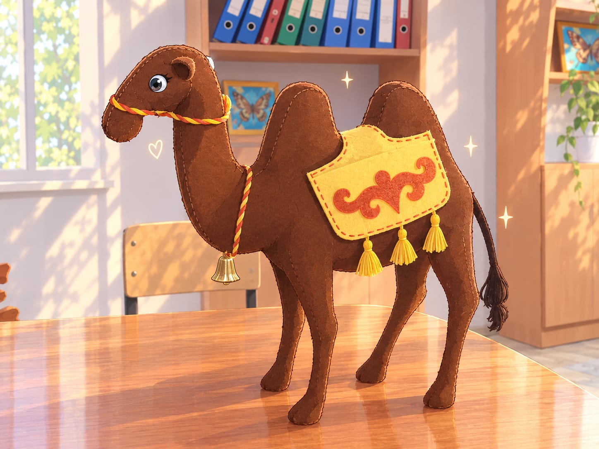

# 🐫 Верблюд из фетра

### Пошаговая инструкция по созданию мягкой игрушки своими руками

<!-- 📸 ШАБЛОН КАРТИНКИ №1: готовая игрушка -->
<!-- Загрузите фото в папку images/ и замените имя файла ниже -->

*Двугорбый верблюд в жёлтой попоне с красным узором, с кисточками и колокольчиком*

---

## 📑 Содержание

1. [Материалы и инструменты](#-материалы-и-инструменты)
2. [Выкройка](#-выкройка)
3. [Вырезание деталей](#️-вырезание-деталей)
4. [Вышивание деталей](#-вышивание-деталей)
5. [Сборка](#-сборка)
6. [Попона и украшения](#-попона-и-украшения)
7. [Финальные штрихи](#-финальные-штрихи)

---

## 🧵 Материалы и инструменты

| Материал | Для чего |
|---|---|
| 🟤 Коричневый фетр | Туловище, голова, ноги, уши |
| 🟡 Жёлтый фетр | Попона |
| 🟠 Красный или оранжевый фетр | Узор на попоне |
| 🧶 Жёлтая пряжа или мулине | Три кисточки на попоне |
| 🪢 Красный и жёлтый шнур | Скрученная уздечка |
| 🔔 Маленький колокольчик | Украшение на шее |
| ⚫ Серые или чёрные бусины | Глаза |
| 🪡 Нитки мулине: коричневые, красные, жёлтые | Швы и вышивка |
| ☁️ Синтепон или холлофайбер | Наполнитель |

**Инструменты:** бумага, карандаш, линейка, ножницы, иголка, булавки, мел для ткани.

---

## 📐 Выкройка

<!-- 📸 ШАБЛОН КАРТИНКИ №2: выкройка -->
<!-- Загрузите фото выкройки в папку images/ и замените имя файла ниже -->

  

Перенесите выкройки на бумагу **в натуральную величину**, соблюдая указанные размеры, и вырежьте шаблоны.

| № | Деталь | Размер | Кол-во |
|:-:|---|---|:-:|
| 1 | Туловище с головой, горбами и двумя ногами | 35 × 28 см | 2 шт |
| 2 | Деталь с двумя ногами (вставка между половинками) | 22 × 20 см | 2 шт |
| 3 | Длинная вставка (спина, горбы и брюшко) | длина 72 см | 1 шт ⚠️ |
| 4 | Вставка поуже (голова и шея) | 27 × 5 см | 1 шт ⚠️ |
| 5 | Клиновидная вставка | длина 14 см | 2 шт ⚠️ |
| 6 | Круги для подошв | диаметр 3 см | 4 шт ⚠️ |
| 7 | Круги для ушей | диаметр 2 см | 2 шт ⚠️ |

> [!NOTE]
> ⚠️ Назначение этих деталей определено по форме на чертеже и по фото готовой игрушки. Сверьтесь со своим чертежом и при необходимости поправьте таблицу.

---

## ✂️ Вырезание деталей

1. **Приколите** бумажные шаблоны булавками к фетру и обведите их мелом или карандашом.
2. **Вырежьте** основные детали из коричневого фетра. Парные детали вырезайте так, чтобы они совпали по форме.
3. **Сравните** детали: сложите их друг с другом и подровняйте края, чтобы они совпадали по размеру и форме.
4. Из **жёлтого фетра** вырежьте прямоугольную попону. Её размер подберите по спине игрушки.
5. Из **красного фетра** вырежьте завитки восточного узора для попоны.

> [!TIP]
> Длинную вставку (72 см) удобнее вырезать из двух частей, а потом сшить в одну полосу на невидимом месте.

---

## 🪡 Вышивание деталей

Все детали вышиваются **обмёточным швом** (петельным швом).

**Как делать обмёточный шов:**

1. Выведите иглу на лицевую сторону у самого края детали.
2. Сделайте новый вкол на 3–4 мм дальше и проведите иглу под нитку, так чтобы она легла петлёй по краю.
3. Затяните нитку не слишком туго и повторяйте шаги по всей длине края.

**Порядок работы:**

1. Пришейте красный узор на жёлтую попону, а затем обшейте попону красными нитками по краю.
2. Обшейте круги для ушей и подошв.
3. Соедините детали туловища, оставив небольшое отверстие для набивки.

---

## 🧸 Сборка

1. Сложите две половины туловища лицевой стороной наружу и соедините их вставками.
2. Набейте игрушку наполнителем. Горбы, ноги и шею набивайте **плотнее**, чтобы верблюд устойчиво стоял.
3. Зашейте отверстие потайным швом.
4. Пришейте круги к низу ног, чтобы получились подошвы.
5. Сложите круги для ушей пополам и пришейте их по бокам головы.

---

## 🎀 Попона и украшения

1. Положите попону между горбами и пришейте её по верхнему краю.
2. Внизу попоны подвесьте три жёлтые кисточки.
3. Скрутите красный и жёлтый шнур в жгут и сделайте из него уздечку на морде, а второй кусок завяжите на шее.
4. Подвесьте колокольчик к шнуру на шее.
5. Для хвоста скрутите коричневые нитки в жгут, на конце сделайте кисточку и пришейте к заду.

---

## ✨ Финальные штрихи

- Пришейте бусины-глаза или вышейте их.
- Вышейте ноздри тёмной ниткой.

**Готово! 🎉 Ваш верблюд может отправляться в караван.**

---

Сделано с ❤️ своими руками

